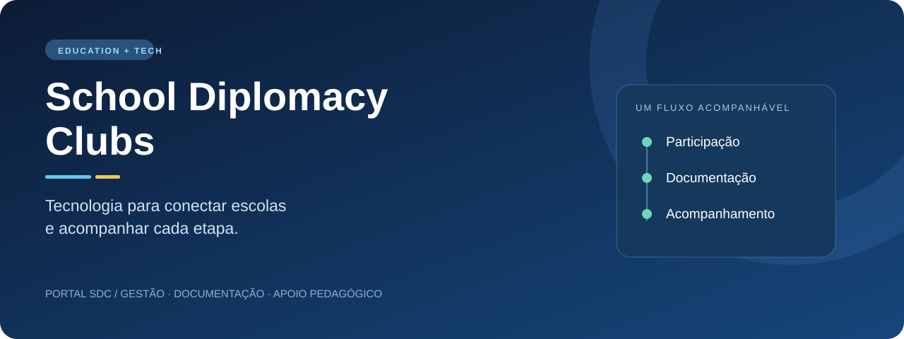
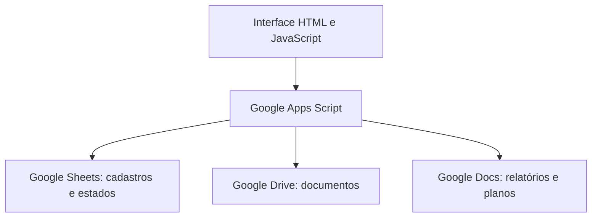

<p align="center"></p>

# School Diplomacy Clubs · Portal SDC

**Gestão educacional para transformar intercâmbio cultural em uma operação acompanhável.**

O Portal SDC reúne acompanhamento de estudantes, situação documental e ferramentas de apoio pedagógico para a coordenação do School Diplomacy Clubs no IEMA, Maranhão. O projeto conecta a experiência de gestão educacional de **Diego Vitor Lopes Gonçalves Souza** à construção de software para uma demanda institucional real.

[Explorar a demonstração](#experimentar) · [Estudo de caso](docs/CASE_STUDY.md) · [Arquitetura](docs/ARCHITECTURE.md) · [Estado do código](docs/RECOVERY.md) · [English](docs/README.en.md)

> **Estado deste repositório:** interface 2.2 recuperada, documentação técnica e demonstração local. A exportação completa do backend Apps Script ainda precisa ser incorporada. Este pacote não constitui uma distribuição implantável do sistema institucional.

## O problema

Coordenar clubes de diferentes escolas exige responder a perguntas simples com dados espalhados: quem continua no programa? Qual documento foi recebido? Qual assinatura já foi conferida? Que escola precisa de acompanhamento?

O portal organiza essas informações em uma interface comum e distingue **cadastro**, **recebimento documental** e **validação humana**. Essa separação evita tratar um arquivo recebido como uma autorização automaticamente aprovada.

## A solução em três frentes

| Gestão | Documentação | Apoio pedagógico |
| --- | --- | --- |
| Indicadores e consulta por escola, ID e nível CEFR | Triagem, vínculo com estudante e conferência de assinatura | Relatórios de situação e planos de aula estruturados |
| Visão consolidada da continuidade | Decisões humanas com justificativa e auditoria no backend descrito | Integração prevista pela interface com Google Docs |

### O que você pode explorar aqui

- Dashboard com gráfico circular e quatro situações documentais.
- Consulta de 24 participantes **inteiramente fictícios**, distribuídos em três escolas de demonstração.
- Filtros combinados por escola, CEFR e ID.
- Navegação pelos módulos e exemplos de triagem e assinatura já revisados.
- Formulários de relatórios e planos de aula, com geração desativada no ambiente demonstrativo.

O piloto B1 aparece na interface recuperada; seu motor não foi importado. Ele não representa certificação CEFR. O gerador de planos descrito no histórico utiliza modelos estruturados, sem dependência de IA paga.

## Experimentar

**Sem instalar nada:** baixe o projeto e abra `demo/index.html` no navegador. O arquivo é autossuficiente, não faz chamadas ao Google e não altera planilhas.

**Para desenvolver:** use Node.js 22 ou superior. O pacote não tem dependências npm.

```sh
npm run build:demo
npm run check
npm test
```

`src/Portal.html` é a interface recuperada para Apps Script. `demo/index.html` é gerado a partir dela com um adaptador local. Não copie o adaptador de demonstração para o ambiente institucional.

## Arquitetura do sistema institucional



A interface usa `google.script.run` para chamar funções de servidor. O histórico do projeto descreve autorização por conta institucional, controle de concorrência e auditoria. Esses mecanismos precisam ser reconferidos na exportação integral antes de uma nova implantação.

## Decisões que importam

1. **Receber não é validar.** O fluxo distingue vínculo documental de conferência de assinatura.
2. **Revisão humana explícita.** Aprovações pedem justificativa e confirmação; o servidor deve revalidar autorização e estado.
3. **Operação acessível à equipe.** A arquitetura aproveita Sheets, Drive e Docs já presentes no trabalho institucional.
4. **Portfólio reproduzível.** A demonstração usa dados sintéticos e bloqueia todas as operações de escrita.

## Organização

| Caminho | Conteúdo |
| --- | --- |
| `src/Portal.html` | Interface recuperada, com URL institucional substituída por configuração |
| `demo/` | Adaptador fictício e demonstração gerada |
| `docs/` | Estudo de caso, arquitetura, contratos, recuperação e apresentação em inglês |
| `scripts/` | Geração da demonstração e verificações estáticas |
| `tests/` | Consistência dos exemplos e bloqueio de operações |
| `.github/workflows/` | Verificação automatizada para futuros pushes e PRs |

## Próximas entregas

- [x] Recuperar e identificar a origem da interface 2.2.
- [x] Criar uma demonstração isolada e documentação de portfólio.
- [ ] Incorporar todos os arquivos `.gs`, HTML auxiliares e `appsscript.json` da versão implantada.
- [ ] Validar o projeto integral em uma planilha de homologação.
- [ ] Evoluir o painel de pendências por escola e a lista de participantes autorizados.

Consulte [RECOVERY.md](docs/RECOVERY.md) para os critérios de conclusão e as limitações já identificadas. As verificações deste pacote não são testes de integração com Google Workspace.

## Autoria e contexto

**Diego Vitor Lopes Gonçalves Souza** · Educação, desenvolvimento de software e automação de processos.

Projeto apresentado no contexto da atuação no Núcleo de Língua Inglesa do IEMA. Este repositório de portfólio não é um canal oficial de inscrição do programa. Não contém cadastros reais, termos, contatos de estudantes ou credenciais. A autorização de redistribuição do código institucional e a licença definitiva ainda devem ser definidas; nenhuma licença de terceiros é presumida.
