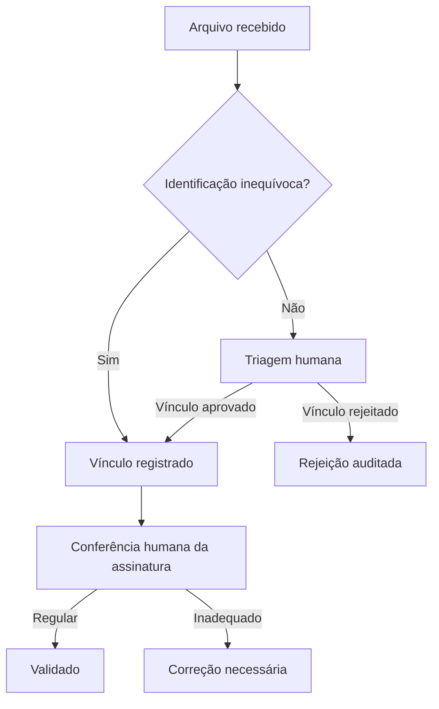

# Arquitetura e decisões

## Fronteiras

| Camada | Responsabilidade | Evidência disponível |
| --- | --- | --- |
| Interface | Navegação, indicadores, filtros, formulários e solicitações de revisão | HTML 2.2 recuperado |
| Apps Script | Autorização, leitura, validação e escrita | Código da versão 18 importado em `apps-script/` |
| Sheets | Cadastros, situações documentais e históricos | Estrutura descrita no projeto |
| Drive | Termos e documentos de trabalho | Fluxo descrito no projeto |
| Docs | Relatórios e planos de aula | Geradores descritos no histórico |

O formulário de atualização escolar é uma implantação separada do portal administrativo. Não foi recuperado neste pacote. A automação de avaliação da Game Jam não integra o escopo deste repositório.

## Fluxo documental

O caminho automático por ID está descrito nos trechos antigos. A compatibilidade entre esse caminho e a listagem de assinaturas precisa ser testada: a listagem apresentada no histórico parte apenas de vínculos aprovados na triagem.

## Modelo de dados observado

| Aba | Uso |
| --- | --- |
| `ALUNOS_BASE` | ID, escola, estudante, continuidade, CEFR e dados cadastrais |
| `ESCOLAS` | Relação de unidades e situação da atualização |
| `REGISTRO_DOCUMENTOS` | ID do estudante, situação, URL, assinatura, data e observação |
| `TRIAGEM_DRIVE` | Identificação de arquivo, sugestão de vínculo e revisão |
| `AUDITORIA_DOCUMENTAL` | Revisor, ação, arquivo, estudante, resultado e justificativa |
| `HISTORICO_RELATORIOS` | Histórico dos documentos gerados |
| `HISTORICO_PLANOS_AULA` | Histórico dos planos gerados |

As posições das colunas são usadas diretamente nos trechos existentes. Antes de refatorar, registrar os cabeçalhos reais em um contrato versionado e executar migrações somente em cópia da base.

## Decisões técnicas

- HTML/CSS/JavaScript sem framework no frontend recuperado.
- Comunicação assíncrona com Apps Script por `google.script.run`.
- Validação de identidade e autorização deve ocorrer no servidor em toda leitura sensível e escrita.
- Bloqueio de concorrência por `LockService` aparece nos trechos de sincronização e revisão.
- Auditoria é uma escrita separada da mudança de estado nos trechos; não há garantia transacional demonstrada.
- Relatórios representam a situação na extração, não reconstituem automaticamente meses anteriores.

## Configuração a recuperar

IDs de planilhas, pastas, revisores autorizados e URL do piloto devem ser configurados fora da demonstração. O HTML sanitizado contém `<?= SDC_PILOT_URL ?>`; o `doGet()` integral deverá fornecer essa variável a um template avaliado, ou a equipe deverá adaptar a ligação ao padrão real do projeto. Não foi criado um `doGet()` substituto neste pacote.

## Demonstração

O adaptador implementa apenas respostas fictícias de leitura. Qualquer outra chamada retorna falha. Dados são clonados a cada resposta, sem rede ou persistência. Relatórios, planos, revisão documental e avaliação não executam ações na demonstração.
